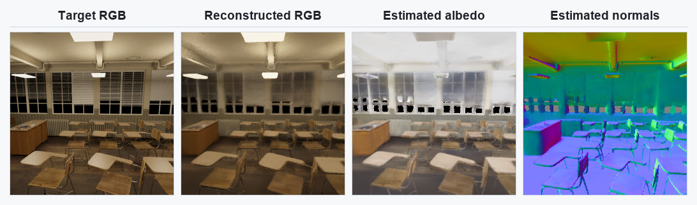
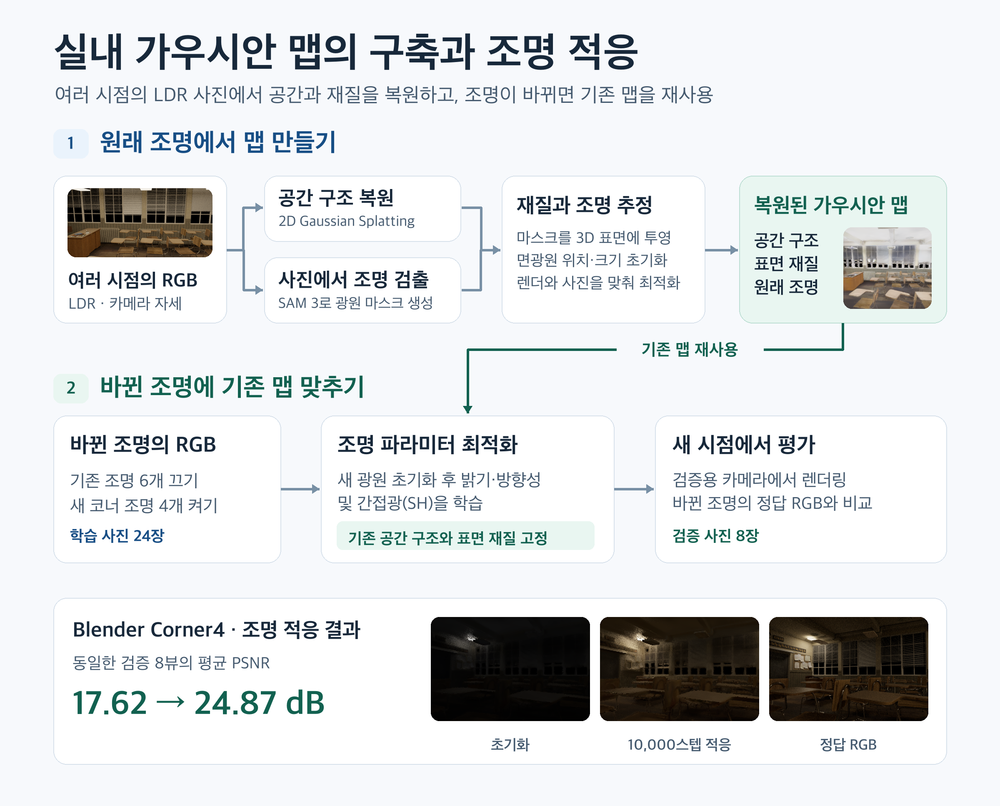
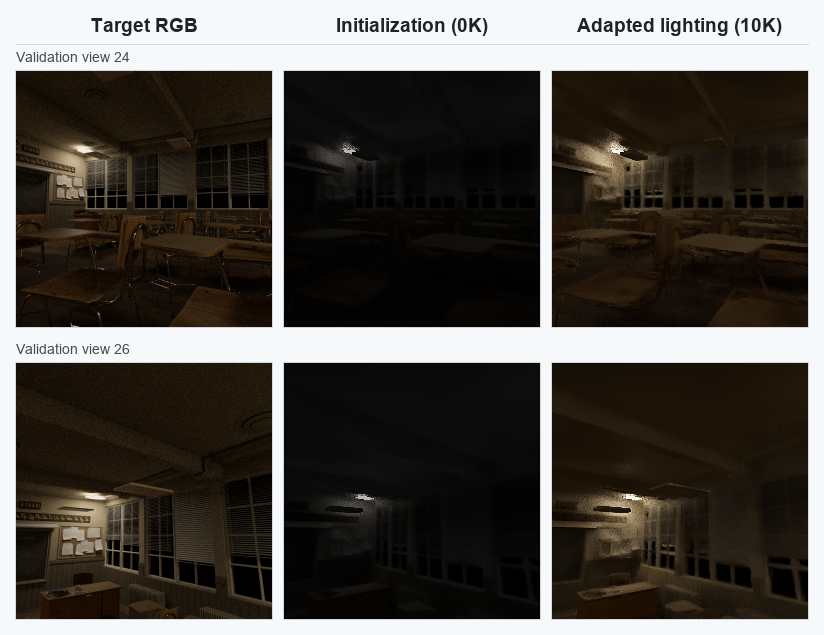

# Relightable Indoor Gaussian Maps from LDR Images

This project uses **AEGIR** (Sabae et al., 2026) as its methodological baseline for indoor inverse rendering. It builds scene geometry from posed LDR RGB images, initializes explicit area emitters from multi-view SAM 3 masks, and fits surface materials and illumination on a shared 2D Gaussian map. [AEGIR paper](https://arxiv.org/abs/2606.28635)



The main Blender run trained 2D Gaussian Splatting for 30,000 steps, then optimized materials and lighting for 5,000 steps. The figure shows `TrainCameras_000`. Over 30 training views at 256 × 256, the mean reconstruction scores were **24.63 dB PSNR**, **0.764 SSIM**, and **0.248 LPIPS**.

## Map construction pipeline



1. **Reconstruct geometry.** Triangulate RGB features with supplied camera poses and intrinsics. Train a native 2D Gaussian scene using photometric supervision and RGB-derived ZoeDepth estimates for relative depth guidance.
2. **Initialize area emitters.** Project SAM 3 fixture masks onto the learned Gaussian surface. Retain evidence supported across multiple views, group the projected points with DBSCAN, and use PCA to fit 3D ellipsoid supports. Tag the Gaussians that contribute to each fixture across views.
3. **Fit materials and illumination.** Hold geometry and emitter supports fixed while optimizing surface materials, directional emitter radiance, scene exposure, and global diffuse irradiance. Direct lighting uses emitter sampling and OptiX shadow visibility. Indirect diffuse lighting uses learned degree-2 RGB spherical harmonics.

For the reported reconstruction experiment, the lighting fit uses a 40-view SAM 3 mask cache and RGB-derived material priors. The direct-light estimator draws 128 samples and averages the central 90% of contributions ranked by luminance.

## Lighting adaptation under changed fixtures



In a separate experiment on the same Blender scene, six original fixtures were switched off and four corner fixtures were switched on. The two rows show cameras from the validation split. The initialization and adaptation renders reuse the same base geometry and materials. After initializing the new lights, the adaptation stage updates their radiance, angular emission, and a global diffuse irradiance term, with the emitter positions, orientations, and extents held fixed.

| Lighting fit | PSNR (dB) ↑ | SSIM ↑ | LPIPS ↓ |
| --- | ---: | ---: | ---: |
| After emitter initialization (0 steps) | 17.62 | 0.438 | 0.567 |
| After lighting adaptation (10,000 steps) | 24.87 | 0.716 | 0.337 |

The lighting fit uses 24 posed RGB views. Both rows of the table average over the same eight held-out validation views at 256 × 256, with matched random seeds, 32 direct-light samples per pixel, fixed exposure, and the same valid-pixel masks. These results measure RGB reconstruction under the changed lighting in this synthetic scene.

## Run the pipeline

Use Linux with an NVIDIA CUDA GPU. Install the Python package and the bundled
rasterizer and OptiX tracer in the active training environment. See the
[extension setup](external/README.md). Geometry preparation uses Open3D, the
Nerfstudio COLMAP parser, and OpenCV. Use the versions in your 2DGS training
environment. The full geometry stage also requires the patched native 2DGS
trainer from the workspace backup at `../external/dn-splatter-2dgs` (or set
`TWO_DGS_ROOT`). Set `DNS_ENV` to the training environment prefix when it differs
from the server default. Use Bash 4 or later for the launcher.

The launcher expects the prepared Blender/Conference scene layout used in the
experiments. It consumes posed RGB and a fixed-pose COLMAP model, an unaligned
ZoeDepth cache, an LDR SAM 3 mask cache, and RGB-derived DiffusionRenderer
material priors. The cache layout and input checks are documented in the
[server setup](docs/SERVER_PIPELINE_MIGRATION_20261006.md). The launcher uses a
validated OptiX 580.173.02 runtime on the original server. `OPTIX_DRIVER_LIB`
can point to an alternative location for those runtime libraries.

```bash
# Check prepared Blender inputs and run the reported 30K geometry configuration.
ITERATIONS=30000 bash scripts/run_gtfree_central90_from_scratch.sh --check-only blender
ITERATIONS=30000 bash scripts/run_gtfree_central90_from_scratch.sh blender
```

Omit `ITERATIONS=30000` to use the current 20K geometry default. The
[reconstruction protocol](docs/GT_FREE_CENTRAL90_RESTART_20261010.md) records
training and evaluation settings. `scripts/prepare_sam3_training_view.py`
assembles a training view from existing SAM 3 masks, and
`scripts/run_triangulated30k_tagged_aegir5k.sh` initializes emitters and fits
lighting from a prepared geometry checkpoint. Use `LIGHTING_MODE=direct_only_learned_indirect`
for that stage when running it separately.

The figures come from separate experiments. The changed-lighting result uses
a previously fitted base scene and a checkpoint that initializes the four new
emitters on that base. See the [corner-fixture protocol](docs/CORNER4_DIRECT_SH_ADAPTATION_20261007.md)
for its inputs and `scripts/run_blender_corner4_direct_sh_10k.sh` command.

## Citation

Mohamed Shawky Sabae, Philipp Langsteiner, Jan-Niklas Dihlmann, and Hendrik Lensch. *AEGIR: Modeling Area Emitters for Indoor Inverse Rendering Using Gaussian Splatting*. 2026. [arXiv:2606.28635](https://arxiv.org/abs/2606.28635)

```bibtex
@misc{sabae2026aegir,
  title = {{AEGIR}: Modeling Area Emitters for Indoor Inverse Rendering Using Gaussian Splatting},
  author = {Sabae, Mohamed Shawky and Langsteiner, Philipp and Dihlmann, Jan-Niklas and Lensch, Hendrik},
  year = {2026},
  eprint = {2606.28635},
  archivePrefix = {arXiv},
  primaryClass = {cs.CV},
  url = {https://arxiv.org/abs/2606.28635}
}
```
