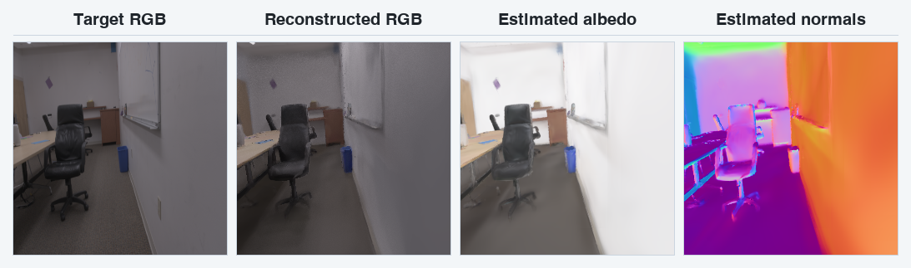
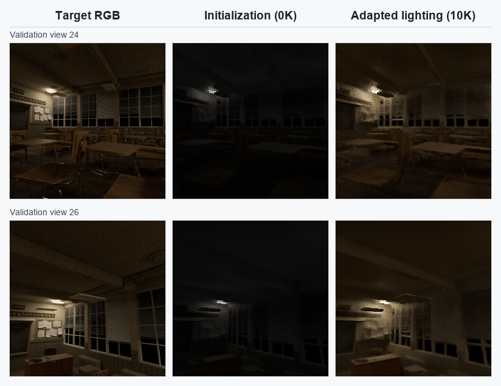

# Blender and Conference experiment results

[Download the per-view metrics](per-view-metrics.csv). The CSV contains 120 reconstruction evaluations and 88 Blender lighting-adaptation evaluations. LPIPS uses the AlexNet backbone.

## Reconstruction under the original lighting

The Blender room and the FIPT-Real Conference scene each used 30,000 geometry optimization steps and 5,000 material and lighting fitting steps. Each row averages 30 training views at 256 × 256. Within a scene, the two sample budgets render the same checkpoint and camera set. The direct-light estimator retains the central 90% of the samples by luminance.

| Scene | Direct-light samples per pixel | PSNR (dB) ↑ | SSIM ↑ | LPIPS ↓ |
| --- | ---: | ---: | ---: | ---: |
| Blender | 128 | 24.63 | 0.764 | 0.248 |
| Blender | 512 | 24.65 | 0.776 | 0.232 |
| FIPT-Real Conference | 128 | 26.30 | 0.838 | 0.277 |
| FIPT-Real Conference | 512 | 26.31 | 0.857 | 0.225 |

### Blender room

### FIPT-Real Conference

[Reconstruction protocol](../docs/GT_FREE_CENTRAL90_RESTART_20261010.md)

## Blender Corner4 lighting adaptation

Six original fixtures were turned off and four corner fixtures were turned on. The adaptation fitted lighting from 24 training views while keeping the base geometry and materials fixed. Both rows average the same eight validation frames (24–31) at 256 × 256 with 32 direct-light samples per pixel and matched seeds.

| Lighting fit | PSNR (dB) ↑ | SSIM ↑ | LPIPS ↓ |
| --- | ---: | ---: | ---: |
| After emitter initialization (0 steps) | 17.62 | 0.438 | 0.567 |
| After lighting adaptation (10,000 steps) | 24.87 | 0.716 | 0.337 |

[Lighting adaptation protocol](../docs/CORNER4_DIRECT_SH_ADAPTATION_20261007.md)
