# Reconstruction results

Selected original render comparisons from the LDR Blender and FIPT-Real Conference experiments. Each PNG shows the **target RGB on the left** and the **reconstructed RGB on the right** (256 × 256 per image). The ten training views per scene are sampled evenly from the 30 evaluated views of the 30K geometry / 5K inverse-rendering runs, at 128 direct-light samples per pixel.

[Training settings, reconstruction metrics and lighting-adaptation results](../README.md)

## FIPT-Real Conference

| View | View |
| --- | --- |
| 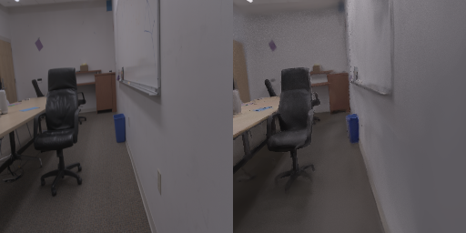 Frame 0000 | 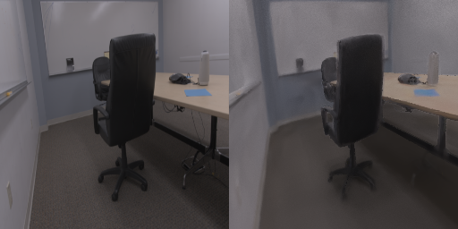 Frame 0014 |
| 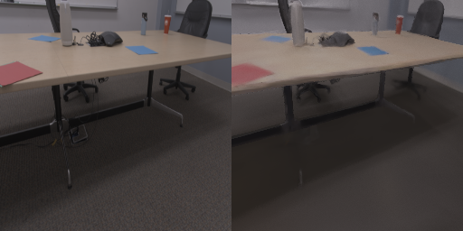 Frame 0029 | 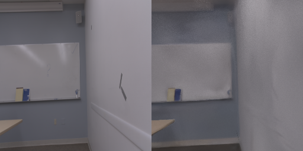 Frame 0048 |
| 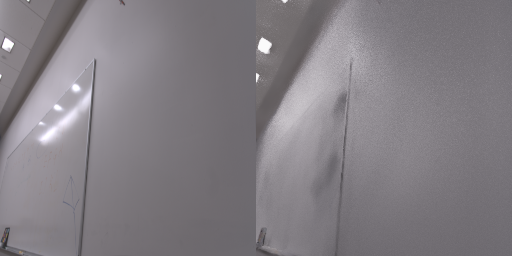 Frame 0063 | 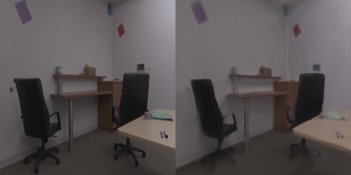 Frame 0077 |
| 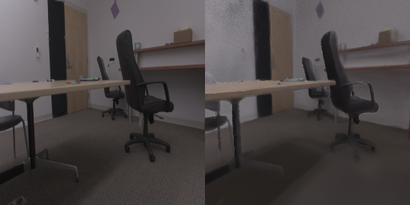 Frame 0092 | 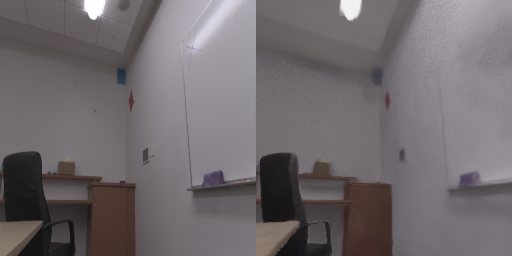 Frame 0112 |
| 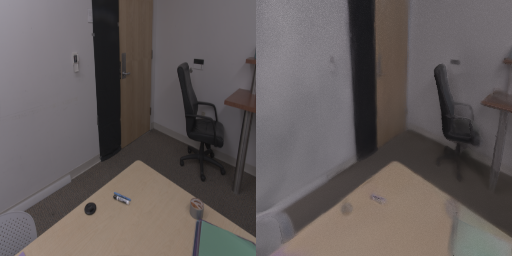 Frame 0126 | 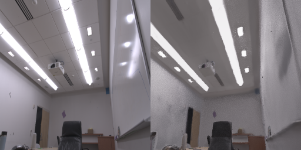 Frame 0141 |

## Blender room

| View | View |
| --- | --- |
| 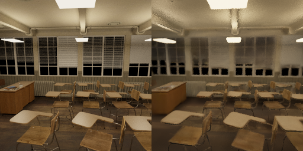 Frame 0000 | 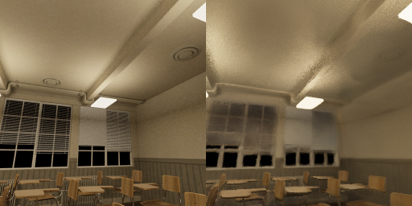 Frame 0009 |
| 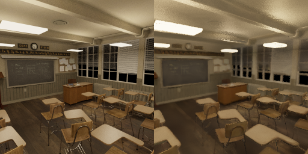 Frame 0018 | 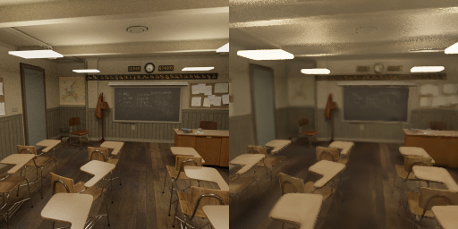 Frame 0030 |
| 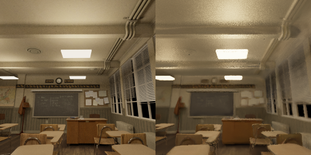 Frame 0039 | 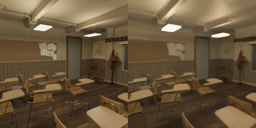 Frame 0048 |
| 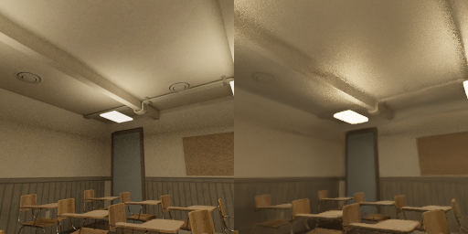 Frame 0057 | 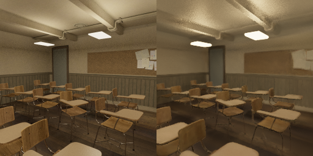 Frame 0070 |
| 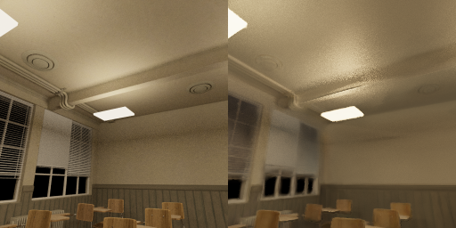 Frame 0079 | 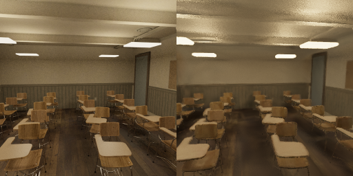 Frame 0088 |
